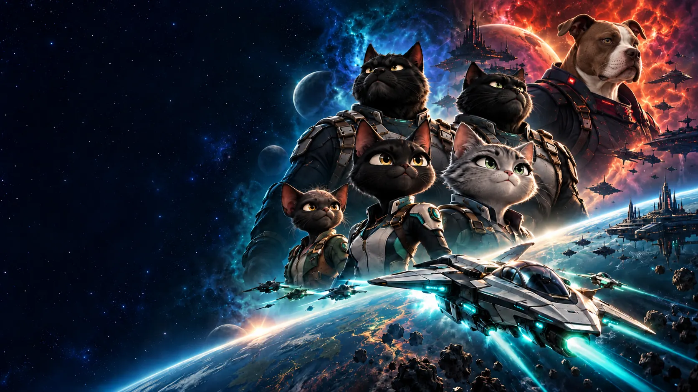
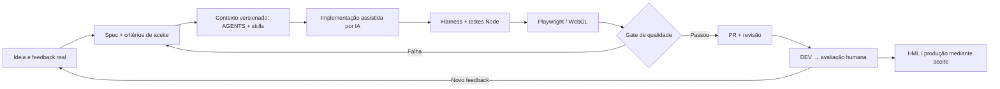
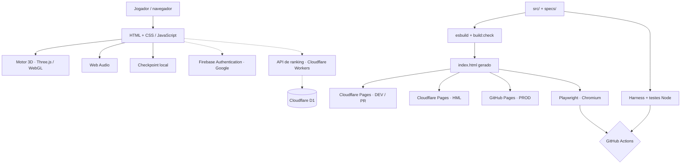

<div align="center">

# NOVA WING 3D

### FIVE CATS · Uma aventura espacial inspirada nos meus pets



<sub>A arte da tela inicial do jogo · Os personagens nasceram da inspiração nos meus pets.</sub>

**Dos meus pets a uma aventura espacial — e da ideia a um jogo desenvolvido com engenharia assistida por IA.**

[](https://github.com/trucco86/nova-wing-3d/actions/workflows/ci.yml)
[](package.json)
[](src/visuals.js)
[](tests/browser/)
[](LICENSE)

**[JOGAR · PRODUÇÃO](https://trucco86.github.io/nova-wing-3d/)** &nbsp;·&nbsp; **[TESTAR · DEV](https://dev.nova-wing-preview.pages.dev/)** &nbsp;·&nbsp; **[EXPLORAR O CASE DE AI SDLC](docs/case/README.md)**

</div>

---

## Uma história que começou com meus pets

O **Nova Wing** nasceu de uma ideia simples e pessoal: imaginar meus pets como protagonistas de um jogo de naves. **Bia, Jenifer, Christopher, Bob e Calvinho** inspiraram os cinco pilotos do esquadrão **Five Cats**. Já **Marvin**, meu pitbull, ganhou um papel bem diferente na ficção: ele é o grande vilão da aventura.

Na história, Marvin rouba os suprimentos dos gatos e foge para o espaço profundo. Liderados por Bia, os Five Cats partem em suas naves para recuperar o que foi levado, atravessando setores, enfrentando inimigos e chefes e descobrindo novas formas de combate.

O jogo é, ao mesmo tempo, uma homenagem divertida aos animais que fazem parte da minha vida e um projeto pessoal para experimentar **desenvolvimento de games, IA aplicada ao ciclo de software e qualidade de engenharia**.

## O que é este projeto?

O **Nova Wing 3D** é um rail shooter 3D desenvolvido como hobby, com uma campanha de dez setores, os pilotos Five Cats, naves transformáveis, chefes, combates estratégicos e controles para desktop e celular.

Mas há uma segunda história: **como usar IA na engenharia de software para transformar ideias e feedback em mudanças verificáveis, sem perder rastreabilidade, qualidade e capacidade de voltar atrás?**

É esse o case. O jogo torna os problemas concretos: um botão que fica sobre a nave, um chefe inacessível, um áudio cansativo ou um build divergente. As correções passam por especificação, alteração de fonte, harness, testes, revisão e deploy.

| Explore o produto                                              | Explore o processo                                          |
| :------------------------------------------------------------- | :---------------------------------------------------------- |
| [Jogar no navegador](https://trucco86.github.io/nova-wing-3d/) | [Case de engenharia assistida por IA](docs/case/README.md)  |
| [Guia do jogo e das mecânicas](docs/GAMEPLAY-GUIDE.md)         | [Mapa visual do AI SDLC](docs/PORTFOLIO-AI-SDLC.md)         |
| [Dez setores e seus chefes](src/campaign.js)                   | [Evidências, commits, PRs e gates](docs/case/EVIDENCIAS.md) |
| [Versões e evolução](CHANGELOG.md)                             | [Como reproduzir o experimento](docs/case/REPRODUZIR.md)    |

## O case: da intenção à evidência



**O diferencial não é gerar código automaticamente.** É aproximar descoberta, implementação, verificação e decisão de release em um ciclo que deixa rastros no repositório.

| Pilar                      | Implementação inspecionável                                                                                          | O que ainda não significa                             |
| :------------------------- | :------------------------------------------------------------------------------------------------------------------- | :---------------------------------------------------- |
| **Context engineering**    | [AGENTS.md](AGENTS.md), [skills](skills/README.md), [specs](specs/README.md)                                         | Que cada agente siga instruções sem falhas            |
| **Harness determinístico** | [tests/harness.mjs](tests/harness.mjs), [src/game.js](src/game.js)                                                   | Que mocks substituam o WebGL real                     |
| **Qualidade em camadas**   | [Node + Playwright](docs/TESTES.md), [CI](.github/workflows/ci.yml)                                                  | Que CI verde seja homologação em celular              |
| **Entrega rastreável**     | [PRs](https://github.com/trucco86/nova-wing-3d/pulls), [releases](releases/), [deploys](docs/DEPLOY-ENVIRONMENTS.md) | Que um preview aprovado esteja em produção            |
| **Aprendizado contínuo**   | [ADRs](docs/adr/), [case](docs/case/CASE-STUDY.md), [métricas](docs/case/METRICAS.md)                                | Que ROI ou produtividade já tenham baseline confiável |

> [!IMPORTANT]
> **Transparência técnica:** o projeto demonstra desenvolvimento **assistido por IA**, com instruções, skills e controles reais. A orquestração autônoma de agentes independentes, com handoffs instrumentados, é uma **evolução proposta**, não uma capacidade já comprovada. Não apresentamos percentuais de produtividade sem medições comparáveis.

### Uma evolução documentada, com falhas reais

No ciclo de outubro de 2026, as mudanças de menu, login e áudio exigiram sincronização do HTML gerado, correções de formatação e atualização coordenada de versão. A suíte de navegador encontrou ainda uma falha no menu em **paisagem mobile**, corrigida em uma release posterior. Isso oferece um exemplo concreto de como o feedback e o CI detectam problemas que não aparecem em uma demonstração estática.

**[Leia o ciclo completo, com PRs e execuções](docs/case/CICLO-REAL-OUTUBRO-2026.md).**

## O jogo em poucas linhas

- **Cinco pilotos** com perfis próprios: Bia, Jenifer, Christopher, Bob e Calvinho.
- **Dez setores** com ambientação, subchefes e chefes específicos, até Marvin.
- **Nave e robô** com comportamentos distintos, boost, pods e disparos especiais.
- **Progressão** com arsenal, melhorias, créditos, checkpoints e mapa da campanha.
- **Web first:** teclado, toque, paisagem mobile, áudio procedural e renderização Three.js/WebGL.

O [guia completo](docs/GAMEPLAY-GUIDE.md) descreve controles e mecânicas. Este repositório é uma evolução 3D do [Nova Wing original](https://github.com/trucco86/nova-wing), com implementação própria baseada em Three.js.

<div align="center">
  
  <br />
  <sub>Gameplay real em WebGL · As versões de produção e DEV podem ser diferentes.</sub>
</div>

## Arquitetura de produto e entrega



As linhas pontilhadas indicam integrações condicionais ou dependentes de configuração e homologação. **A existência de código para identidade/ranking não comprova que todos os serviços remotos estejam provisionados.** Veja [arquitetura de plataforma](docs/ARCHITECTURE-PLATFORM.md), [ambientes](docs/DEPLOY-ENVIRONMENTS.md) e [ranking](docs/RANKING-CLOUDFLARE.md).

### Ambientes e políticas

| Ambiente       | Acesso                                                | Papel                                          |
| :------------- | :---------------------------------------------------- | :--------------------------------------------- |
| **PROD**       | [Jogar](https://trucco86.github.io/nova-wing-3d/)     | Release pública proveniente de `main`          |
| **DEV**        | [Testar](https://dev.nova-wing-preview.pages.dev/)    | Integração rápida e validação visual/funcional |
| **HML**        | [Homologar](https://hml.nova-wing-preview.pages.dev/) | Candidata estável, distinta de DEV             |
| **PR preview** | URL `pr-N` quando publicada                           | Revisão isolada de uma alteração               |

> [!NOTE]
> As versões podem variar entre ambientes. Um deploy bem-sucedido comprova publicação de um artefato específico, não aceite funcional. Consulte sempre o [registro de ambiente e o SHA](docs/DEPLOY-ENVIRONMENTS.md).

## Engenharia reproduzível

**Pré-requisito:** Node.js 24 e npm. O jogo pode ser executado sem backend remoto; login e ranking online dependem de configuração separada.

```bash
git clone https://github.com/trucco86/nova-wing-3d.git
cd nova-wing-3d
npm ci
npm run build
npm run dev
```

Abra `http://127.0.0.1:4173`. Para inspecionar os gates:

```bash
npm run build:check
npm run validate
npx playwright install chromium
npm run validate -- --browser
```

**Nunca edite `index.html` manualmente.** O código-fonte está em `src/`, e o build deve reproduzir o artefato entregue.

### Onde começar a ler

| Interesse                        | Leitura recomendada                                           |
| :------------------------------- | :------------------------------------------------------------ |
| **Visão executiva / portfólio**  | [Vitrine AI SDLC](docs/PORTFOLIO-AI-SDLC.md)                  |
| **Case completo**                | [Case de desenvolvimento](docs/case/README.md)                |
| **Arquitetura técnica**          | [Stack / ambientes](docs/ARCHITECTURE-PLATFORM.md)            |
| **Responsabilidades de agentes** | [Papéis e handoffs propostos](docs/case/PAPEIS-E-HANDOFFS.md) |
| **Métricas e DORA**              | [Plano de instrumentação](docs/case/METRICAS.md)              |
| **Evidência e limitações**       | [Matriz de evidências](docs/case/EVIDENCIAS.md)               |
| **Rodar / reproduzir**           | [Guia de reprodução](docs/case/REPRODUZIR.md)                 |
| **Catálogo de documentos**       | [Índice da documentação](docs/README.md)                      |

<details>
<summary><strong>Executive abstract · English</strong></summary>

Nova Wing 3D is a playable WebGL space shooter and a documented AI-assisted software delivery experiment. The goal is to shorten the loop from idea to validated change using versioned context, domain skills, specifications, deterministic tests, browser checks and traceable CI/CD. It is an engineering case study with real code, PRs and deploy evidence—not a claim of proven autonomous agents or measured productivity gains.

</details>

---

<div align="center">
  <strong>Build the idea. Test the behavior. Keep the evidence.</strong><br/>
  <sub>Nova Wing 3D · Five Cats · MIT License · <a href="THIRD_PARTY_NOTICES.md">Third-party notices</a></sub>
</div>
