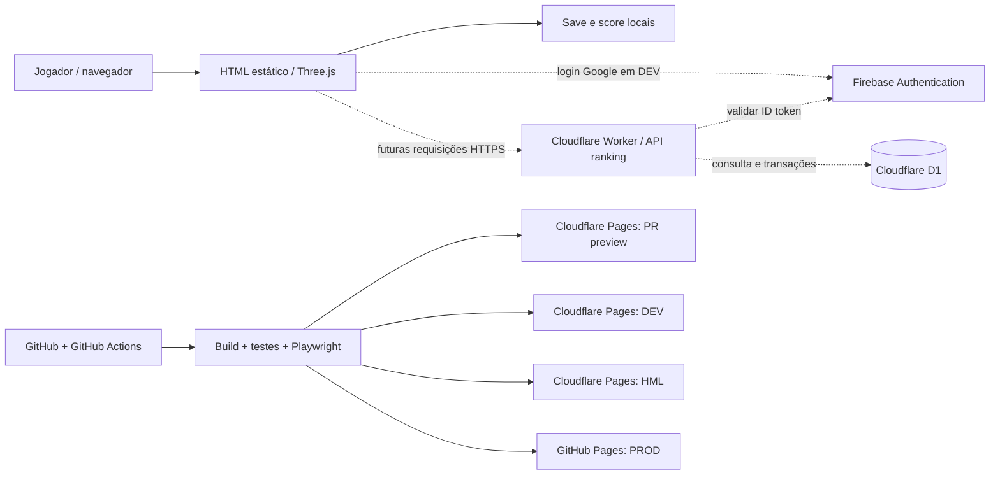

# Nova Wing — arquitetura da plataforma e evolução (outubro/2026)

> **Fonte de verdade:** este documento distingue estado **implementado**, **publicado**, **homologado** e **proposto**. CI verde valida código/testes; não comprova login OAuth real, qualidade visual/sonora nem segurança de um ranking ainda não implantado.

## Estado de referência mais recente — 28/10/2026

> Esta seção atualiza o panorama de versões sem apagar a matriz histórica abaixo. Para o status de um recurso específico, consulte o SHA correspondente e os gates do próprio ambiente.

| Branch | Versão na consulta | Uso / evidência                                                                                                                          |
| :----- | :----------------- | :--------------------------------------------------------------------------------------------------------------------------------------- |
| `dev`  | **1.27.4**         | [Cloudflare DEV](https://dev.nova-wing-preview.pages.dev/) · [deploy](https://github.com/trucco86/nova-wing-3d/actions/runs/40744797302) |
| `hml`  | **1.24.24**        | [Cloudflare HML](https://hml.nova-wing-preview.pages.dev/)                                                                               |
| `main` | **1.24.18**        | [GitHub Pages PROD](https://trucco86.github.io/nova-wing-3d/)                                                                            |

A candidata [PR #135](https://github.com/trucco86/nova-wing-3d/pull/135) introduz cenário de Developer/QA e nova hierarquia de piloto na missão, **sem pressupor publicação definitiva em DEV**. A API de ranking possui módulos no repositório, mas a existência da fonte não comprova D1 provisionado ou serviço operacional.

**Visão do case:** [Portfólio AI SDLC](PORTFOLIO-AI-SDLC.md) · [Ciclo auditável](case/CICLO-REAL-OUTUBRO-2026.md) · [Matriz de evidências](case/EVIDENCIAS.md)

## 1. Visão executiva

O jogo é um cliente WebGL/Three.js, com HTML estático produzido por esbuild. A evolução separa três responsabilidades:

1. **Frontend/jogabilidade** — `src/`, build gerado em `index.html` e progresso local validado em `src/campaign.js`.
2. **Identidade** — Firebase Authentication (provedor Google) integrado ao frontend **somente em DEV**, ainda pendente de homologação humana.
3. **Distribuição e ranking** — Cloudflare Pages **implantado** para DEV/HML/previews; **Cloudflare Workers + D1 para API/ranking são arquitetura-alvo, não serviços em produção**.

A produção do jogo permanece no GitHub Pages (`main`, release `v1.24.1` na última verificação documentada). O ranking público não existe nesta fase.

**Legenda:** setas contínuas representam integrações já presentes. Setas pontilhadas representam fluxos planejados ou ainda não homologados. O caminho `QA → ambientes` depende dos gates específicos de cada ambiente; **preview experimental não representa CI completa aprovada**.

## 2. Matriz de componentes e estado verificado

| Componente                                            | Responsabilidade                                                     | Evidência                                                                     | Estado                                      |
| ----------------------------------------------------- | -------------------------------------------------------------------- | ----------------------------------------------------------------------------- | ------------------------------------------- |
| `src/main.js`, `game.js`, `visuals.js`, `campaign.js` | Bootstrap, jogo, renderização e estado                               | Código versionado em `dev`                                                    | Implementado                                |
| `tools/build.mjs`, `index.html`                       | Bundle HTML reproduzível                                             | `build:check` no harness                                                      | Implementado                                |
| `src/google-auth.js`                                  | Google sign-in, sessão persistente, logout, modo visitante           | PR [#59](https://github.com/trucco86/nova-wing-3d/pull/59) integrada em `dev` | Publicado em DEV; OAuth real não homologado |
| `cloudflare-preview.yml`                              | Publicação estática isolada, aliases por branch/PR                   | Workflows e URLs em [DEPLOY-ENVIRONMENTS](DEPLOY-ENVIRONMENTS.md)             | DEV/HML e previews publicados               |
| `ci.yml`, `tests/ci-workflow.test.mjs`                | Gates quality/browser e proteção contra HTML desatualizado em shards | PR #59, 139 testes unitários e quatro shards aprovados                        | Implementado                                |
| Cloudflare Worker API do ranking                      | Validação de sessão, score e leitura do ranking                      | Contrato em [RANKING-CLOUDFLARE](RANKING-CLOUDFLARE.md)                       | **Proposto; não existe endpoint ativo**     |
| Cloudflare D1                                         | Histórico de runs, score verificado e leaderboard por temporada      | Esquema lógico documentado                                                    | **Proposto; banco não provisionado**        |
| Firestore/Cloud Functions do ranking                  | Alternativa anterior de backend                                      | PR [#57](https://github.com/trucco86/nova-wing-3d/pull/57) em draft           | Não integrado, não publicado                |

## 3. Ambientes e fluxo de promoção

| Camada            | Fonte             | Hospedagem                           | Finalidade e política                                                 |
| ----------------- | ----------------- | ------------------------------------ | --------------------------------------------------------------------- |
| PR preview `pr-N` | Branch de feature | Cloudflare Pages `nova-wing-preview` | Inspeção experimental de UX/arte/áudio; build válido não libera merge |
| DEV               | `dev`             | `dev.nova-wing-preview.pages.dev`    | Integrações e teste do Firebase Google; requer gates conforme fluxo   |
| HML               | `hml`             | `hml.nova-wing-preview.pages.dev`    | Versão candidata para aceite visual, funcional e regressão            |
| PROD              | `main`            | GitHub Pages                         | Apenas release aprovada com gates e controle de rollback              |

As URLs Cloudflare são publicamente acessíveis por padrão; acesso público não implica autorização para escrita no futuro ranking. Domínios estáticos de DEV/HML evitam registrar cada hostname `pr-N` no Firebase OAuth.

**Estado registrado na última evidência (25/10/2026 UTC):** DEV publicou commit `e836b14` (integração da PR #59); HML permaneceu baseline `1.24.1`; preview experimentais #54/#51/#46/#43 foram implantados isoladamente; `main` não foi promovida nessa rodada. Validar novamente SHA e `BUILD.txt` antes de qualquer nova promoção.

Documentação operacional: [DEPLOY-ENVIRONMENTS](DEPLOY-ENVIRONMENTS.md). A política de status é `planejado → implementado → CI aprovado → publicado → homologado`; os estados não são intercambiáveis.

## 4. Fronteiras de confiança e dados

- **Jogo no navegador não é fonte confiável de pontuação**: scripts, relógio e payload podem ser alterados. Não aceitar `uid`, score ou timestamp arbitrários do cliente como autoridade.
- **Firebase é provedor de identidade, não um backend de score**. O cliente obtém um ID token; um Worker futuro deve verificar assinatura e claims antes de atribuir identidade ao `uid`.
- **Cloudflare Pages não é Cloudflare Workers nem D1**. O deploy atual entrega somente arquivos estáticos; ranking exigirá nova infraestrutura, endpoints e migrations.
- **Persistência atual é local**. Login Google em DEV **não sincroniza** compras, itens, save, conquistas ou score entre dispositivos.
- **Visitante continua jogando sem conta**. Ranking competitivo exige autenticação opt-in e resultado validado no backend. Não fazer login obrigatório para campanha offline.
- **Firebase Web config é pública**; nunca armazenar segredo de service account, token de Cloudflare, credenciais do banco ou valores administrativos no frontend, docs ou logs.
- **Privacidade:** ranking público deve expor apelido e score, não email, UID, tokens ou dados de perfil; definir consentimento, retenção, moderação e exclusão antes de lançamento.

Veja [AUTH-FIREBASE](AUTH-FIREBASE.md) e [RANKING-CLOUDFLARE](RANKING-CLOUDFLARE.md) para fluxos, controles e plano.

## 5. Evolução de arquitetura e harness

Mudanças concretas adotadas:

- Separação entre `main`, `dev`, `hml` e branches de PR, com Cloudflare Pages para testes e GitHub Pages para produção.
- Build reproduzível obrigatório nos runners **independentes** de Playwright: `npm ci → npm run build → npm run validate -- --browser`. Antes, quatro shards falhavam por verificar uma versão não gerada no runner.
- `quality` realiza build/validação e `browser` agrega quatro shards; screenshots, logs e artefatos `validation.json` são evidências, não autorização automática de publicação.
- Workflow experimental de algumas PRs aceita build para revisão visual; **não** dispensa quality/browser para promoção.
- Versões da release devem ser sincronizadas no pacote, lockfile, notas, `index.html` e metadados iOS. Houve correções manuais na PR #59; a automação total de bump e iOS **continua pendente**.
- `Android/iOS` seguem como opt-in (`NOVA_BUILD_NATIVE=true`), sem publicação nativa no desenvolvimento web-first.

Registros de decisão: [ADR-0001](adr/0001-ambientes-e-publicacao.md), [ADR-0002](adr/0002-identidade-e-ranking.md) e [ADR-0003](adr/0003-harness-e-gates.md).

## 6. Direção de arte como contrato de produto

A evolução para robô voador e novas naves é independente da autenticação/ranking, porém compartilha os mesmos gates de preview. O conceito aprovado exige mecha mais angular e agressivo, asas maiores integradas aos ombros e costas, turbina principal alta entre os ombros, painelização mecânica e braços elevados ao disparar. A mesma linguagem deve orientar as cinco naves. **O preview #54 é protótipo visual e não está aprovado para promoção.**

Detalhamento: [DESIGN-MECHA-STARFIGHTER](DESIGN-MECHA-STARFIGHTER.md).

## 7. Pendências e próximos gates

1. Homologar popup/redirect, sessão persistente, logout e visitante no domínio real DEV com Google; registrar evidências sem armazenar tokens.
2. Finalizar redesenho mecha/naves no preview, CI e aceite visual antes de integrar em DEV/HML.
3. Provar rollback em ambiente não produtivo e automatizar sincronização de versões.
4. Implementar Worker + D1 em infraestrutura separada, com testes de verificação de JWT, autorização e antifraude, sem ranking público prematuro.
5. Definir ambiente backend DEV/HML/PROD independente, monitoramento, limites de custo e política LGPD.
