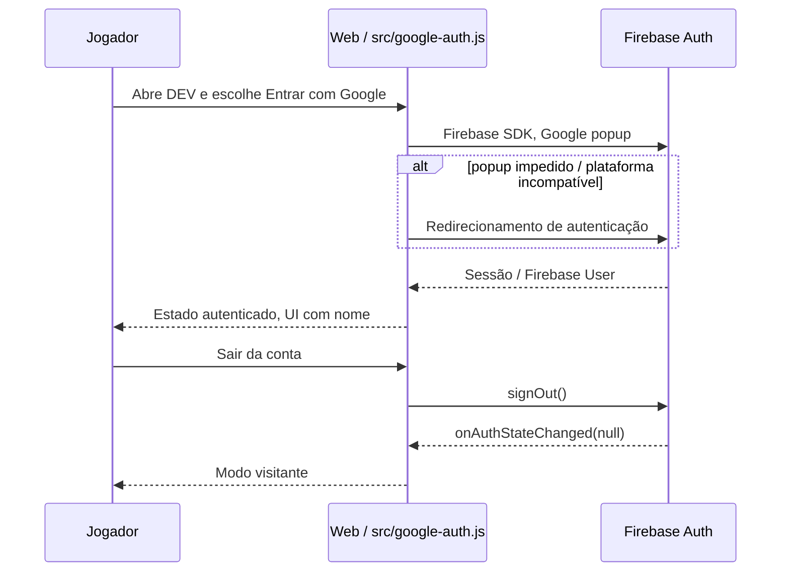

# Firebase Authentication — contrato de login Google (Nova Wing)

**Status (25/10/2026 UTC):** frontend implementado pela [PR #59](https://github.com/trucco86/nova-wing-3d/pull/59), integrado e publicado em **DEV**. CI verde não equivale a uma sessão Google real homologada. O ranking, o banco remoto e a sincronização do save **não** foram implementados.

## Decisão arquitetural

- **Responsabilidade do Firebase Authentication:** autenticar a pessoa e fornecer o Firebase **ID token** que, após validação pelo backend futuro, identifica seu UID.
- **Responsabilidade do frontend:** renderizar painel, permitir login/logout e continuar jogando como visitante. Não calcular score oficial de ranking nem guardar segredos de backend.
- **Responsabilidade da futura API Cloudflare Worker:** verificar token, aplicar autorização e validar runs antes de persistir pontuação no D1. O Firebase Auth não grava pontuação.
- **Backends para DEV/HML/PROD:** manter projeto Firebase de desenvolvimento separado da identidade de produção; projeto atual é `nova-wing-dev`. Não reaproveitar usuários/tokens de teste no ranking PROD.

## Implementação rastreável

- `src/main.js`: chama `installGoogleLogin()` somente fora do Capacitor nativo e mantém cleanup no destroy.
- `src/google-auth.js`: implementa o adaptador Web, SDK Firebase ESM `11.10.0` carregado sob demanda por `www.gstatic.com`, GoogleAuthProvider, popup com fallback redirect, `browserLocalPersistence`, `onAuthStateChanged` e `signOut`.
- `src/shell.html`: painel `#novaAuth`, estado, nome, ações entrar/sair/continuar como visitante.
- `tests/google-auth.test.mjs`: testa ausência de inicialização do login nos hosts de PR e nos testes locais sem opt-in.
- `tests/browser/game.spec.mjs`: cobre a não interferência da UI nas telas mobile e a ausência de requisições Firebase no shell Android offline.

## Domínios, comportamento e isolamento

| Host                               | Firebase SDK                         | Finalidade                                                           |
| ---------------------------------- | ------------------------------------ | -------------------------------------------------------------------- |
| `dev.nova-wing-preview.pages.dev`  | Habilitado                           | Login de integração (domínio autorizado no Firebase)                 |
| `hml.nova-wing-preview.pages.dev`  | Código habilita quando for promovido | Homologação futura, **não confundir com deploy já realizado em HML** |
| `pr-N.nova-wing-preview.pages.dev` | **Desabilitado**                     | Preview experimental sem cadastrar cada novo domínio OAuth           |
| `localhost` / `127.0.0.1`          | Só com `?auth=1`                     | Debug local opt-in; domínio precisa estar permitido no Firebase      |
| GitHub Pages PROD                  | **Desabilitado**                     | Sem reutilização do projeto Firebase DEV                             |
| App Android/iOS offline            | **Desabilitado**                     | Partida sem dependência externa                                      |

A restrição por hostname **não é uma autorização de segurança**. O controle de identidade e score precisa acontecer no Worker, independentemente do hostname do frontend.

## Fluxo de autenticação atual

**Ainda não há** sequência de score remoto: será documentada e implementada em [RANKING-CLOUDFLARE](RANKING-CLOUDFLARE.md).

## Persistência e limites conhecidos

- A sessão usa `browserLocalPersistence`; a duração real depende das políticas do navegador e do Firebase.
- O save do jogo é local, não pertence à conta Google e não é sincronizado entre dispositivos.
- **Débito funcional identificado:** o botão **Continuar como visitante** apenas fecha o painel e altera o texto de status; **não chama `signOut`**. Se já existia sessão autenticada, ela permanece. Registrar como P1 antes de associar runs a UID.
- Tratamento de falhas: popup bloqueado pode abrir redirect; falha de inicialização deixa o jogo disponível como visitante.
- Nenhum endpoint de ranking ou escopo adicional foi introduzido com a PR #59.
- Não registrar `access_token`, `id_token` ou e-mail nos logs ou telemetry.

## Contrato para enviar identidade ao Cloudflare (futuro)

1. Após login e consentimento para competição, obter token com `user.getIdToken()`; usar `Authorization: Bearer <idToken>` **somente por HTTPS**.
2. Worker verifica assinatura RS256 contra chaves oficiais, `kid`, `exp`, `iat`, `aud` (projeto esperado), `iss=https://securetoken.google.com/<project-id>`, `sub` não vazio e `auth_time`. Usar biblioteca de JWT confiável; não considerar `atob()` verificação.
3. Derivar UID do `sub` validado. Não confiar em `uid` informado pelo corpo, query string ou storage local.
4. Projetos DEV e PROD devem ter listas próprias de `aud` e `iss`; tokens de um ambiente nunca valem para outro.
5. Rotas de escrita de score exigem token válido, nonce de run, idempotência, rate limit e validação do resultado.

Referência Firebase: https://firebase.google.com/docs/auth/admin/verify-id-tokens

## Checklist de homologação do login

- [ ] Abrir DEV no desktop e no Android/iOS mobile navegador; conferir botão de conta sem obstruir o menu.
- [ ] Entrar com uma conta Google de teste; verificar nome e estado após reload.
- [ ] Testar popup, cancelamento e fallback redirect onde aplicável.
- [ ] Clicar **Sair**; garantir identidade nula e reentrada válida.
- [ ] Testar modo visitante antes e após login; corrigir a ambiguidade descrita acima.
- [ ] Verificar que PR previews, Android offline e produção não baixam SDK Firebase.
- [ ] Confirmar que nenhum token ou dado pessoal aparece em artefatos e logs.

**Critério de pronto:** executar os testes no host autorizado e anexar evidências à PR/issue. Não marcar OAuth homologado só porque Playwright executou com Firebase desativado.
