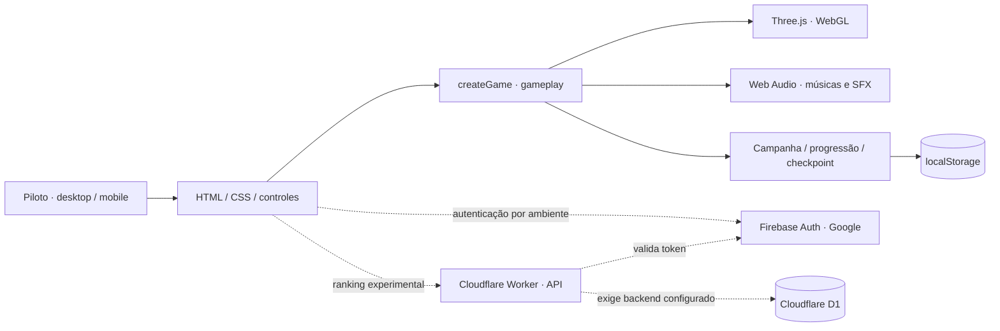
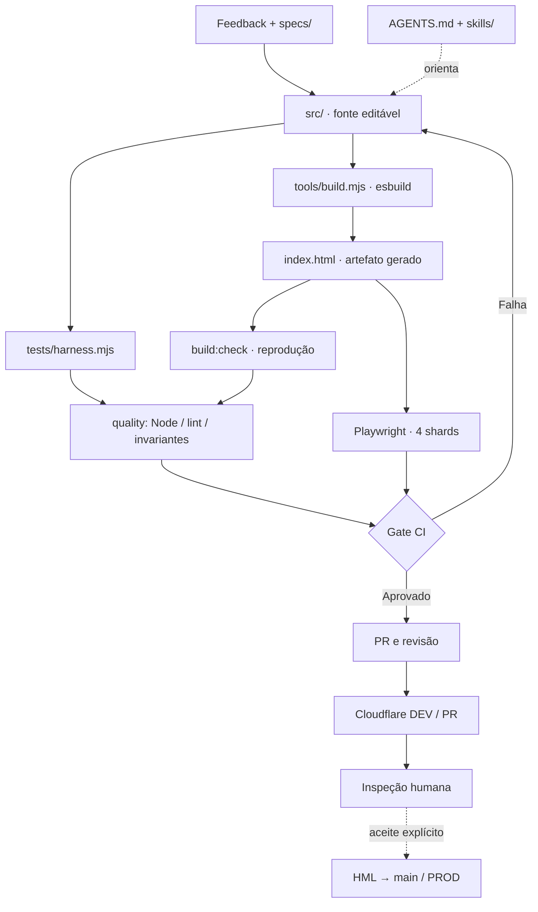
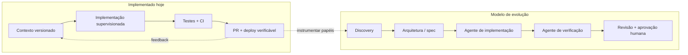

# Arquitetura ilustrada · Nova Wing 3D

**Como as partes do produto e do processo se conectam.** Os diagramas são mantidos em Mermaid no Git: versionáveis, comparáveis em PR e renderizados diretamente no GitHub.

[Voltar à documentação](README.md) · [Portfolio AI SDLC](PORTFOLIO-AI-SDLC.md) · [Arquitetura detalhada](ARCHITECTURE-PLATFORM.md)

## 1 · Runtime e integrações

**Legenda:** setas contínuas representam o fluxo local implementado; setas pontilhadas representam integrações dependentes do ambiente, configuração e validação. O código do Worker não é prova de que um banco ou endpoint esteja operacional.

## 2 · Fonte, build e QA em camadas

O workflow real está em [`.github/workflows/ci.yml`](../.github/workflows/ci.yml); o pipeline Cloudflare usa [`cloudflare-preview.yml`](../.github/workflows/cloudflare-preview.yml). O deploy DEV isolado não executa necessariamente os quatro shards de navegador no mesmo workflow; para promoção, verifique a CI do **mesmo SHA**.

## 3 · Aprendizado e handoff: estado real x proposta

As skills de domínio não são agentes residentes. O desenho de vários papéis é uma **arquitetura futura de orquestração**, cuja viabilidade depende de instrumentação de custo, tempo, rastros e limites de permissão. Leia [Papéis e handoffs](case/PAPEIS-E-HANDOFFS.md).

## 4 · Ambientes sem ambiguidade

| Ambiente | Branch | Hospedagem | Papel |
| :--- | :--- | :--- | :--- |
| PR preview | Branch da PR | Cloudflare Pages | Avaliação de mudança isolada |
| DEV | `dev` | Cloudflare Pages | Integração e feedback rápido |
| HML | `hml` | Cloudflare Pages | Homologação controlada |
| PROD | `main` | GitHub Pages | Release pública |

O estado por versão e a evidência de cada deploy estão em [Ambientes](DEPLOY-ENVIRONMENTS.md). **Publicado ≠ testado ≠ homologado**.

---

**Evidência do fluxo:** [Ciclo real de outubro de 2026](case/CICLO-REAL-OUTUBRO-2026.md) · [Matriz de evidências](case/EVIDENCIAS.md).
