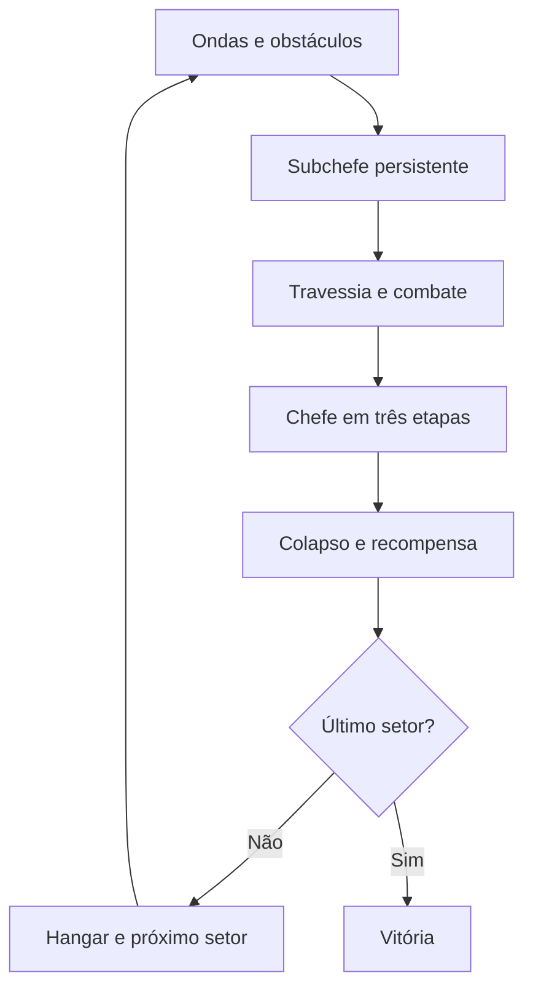

# Nova Wing 3D — Guia do jogo

> Guia de mecânicas, controles, campanha e sistemas de combate. O [README principal](../README.md) é a vitrine do projeto; o [case de AI SDLC](case/README.md) explica como ele é desenvolvido.
>
> **Escopo:** descrição histórica de mecânicas da edição web. Alguns elementos podem ter evoluído nas releases mais recentes; confira [changelog](../CHANGELOG.md) e [specs](../specs/README.md) para detalhes de cada mudança.

## O jogo

Na web, Bia, Jenifer, Christopher, Bob e Calvinho enfrentam a frota de máquinas de Marvin; escolha seu piloto antes da campanha. Cada partida começa com três vidas. A nave avança automaticamente; você controla a posição, desvia dos obstáculos, administra o impulso e escolhe quando carregar plasma, lançar pods ou gastar uma bomba.

- **Dez setores**, cada um com ambiente, chefe e subchefe próprios.
- **Chefes biomecânicos** com dois geradores destrutíveis, núcleo protegido e três etapas de combate.
- **Combate terrestre** com tanques, sentinelas gigantes e passagens de túnel nos ambientes compatíveis.
- **Seis níveis de armamento**, plasma carregado e pods com três evoluções.
- **Hangar entre setores**, créditos, compras e checkpoint local.
- **Trilha sintetizada** que acompanha fase, subchefe, chefe, fúria, colapso e vitória.

É uma edição WebGL inspirada na temática do [Nova Wing original](https://github.com/trucco86/nova-wing), construída com assistência do Codex. Esta versão usa Three.js; o original usa projeção própria em Canvas 2D. Os motores e as regras não são idênticos.

## Controles

| Ação                     | Computador                            | Celular               |
| ------------------------ | ------------------------------------- | --------------------- |
| Pilotar                  | WASD ou setas                         | Joystick esquerdo     |
| Atirar / carregar plasma | Segurar Espaço; soltar libera a carga | Segurar e soltar TIRO |
| Impulso                  | Shift                                 | BOOST                 |
| Giro defensivo           | Q, E ou Z                             | GIRO                  |
| Bomba                    | B ou X                                | BOMBA                 |
| Lançar / recolher pods   | V                                     | LANÇAR / VOLTAR       |
| Pausar / retomar         | P ou Esc; botão de pausa              | Botão de pausa        |
| Música / efeitos         | Botões ♪ e SOM                        | Botões ♪ e SOM        |

No celular, prefira a horizontal. O navegador precisa de WebGL e aceleração gráfica. Não é necessário instalar Node, Java ou aplicativo para jogar. A tela inicial oferece ajuda recolhida em **Como jogar**. Áudio é desbloqueado ao iniciar a missão.

## Mecânicas

### Escudo, vidas e impulso

Você começa com três vidas, 100 de escudo e três bombas. Ao perder uma nave, o próximo piloto assume na mesma posição, com proteção temporária. O giro também protege por um intervalo curto. O boost consome energia e acelera o cenário; soltar permite recuperar energia. Ao esgotar a reserva, o impulso encerra e a energia recarrega; solte Shift ou BOOST e pressione novamente para reativar. A chama alaranjada e os rastros indicam que o impulso está ativo.

### Anéis e armamento

| Item                | Efeito                                                                    |
| ------------------- | ------------------------------------------------------------------------- |
| **Verde, com cruz** | Recupera até 25 de escudo, limitado pela blindagem atual                  |
| **Azul, com setas** | Evolui a arma; a cada três coletados, aumenta o conjunto de pods até três |

Anéis surgem dentro do alcance horizontal da nave, inclusive após redimensionar a tela. A aproximação possui atração de curta distância; a coleta considera o cruzamento em profundidade, inclusive no boost.

| Nível | Arma           | Disparos por rajada | Cor principal |
| ----- | -------------- | ------------------: | ------------- |
| I     | Pulso MK-I     |                   2 | Verde-água    |
| II    | Gêmeo MK-II    |                   2 | Ciano         |
| III   | Tríade MK-III  |                   3 | Azul          |
| IV    | Plasma Vórtice |                   4 | Violeta       |
| V     | Plasma Nova    |                   6 | Roxo          |
| VI    | Aniquilador Ω  |                   8 | Magenta       |

A potência também aumenta o dano. Segurar o tiro mantém as rajadas e acumula plasma; soltá-lo após carga suficiente lança um projétil mais forte.

### Pods: lançamento e retorno

Inspirados no conceito de módulos destacáveis dos shoot 'em ups, os pods possuem núcleo, carcaça e animação próprios. Cada evolução muda a forma e a cadência.

| Estado     | Comportamento                                                          |
| ---------- | ---------------------------------------------------------------------- |
| Acoplado   | Acompanha a nave e dispara com o jogador                               |
| Lançando   | Avança continuamente até a posição de combate                          |
| Destacado  | Mantém posição lateral independente e dispara automaticamente em leque |
| Retornando | Recolhe até a nave sem teletransporte                                  |

No nível III, os disparos usam perseguição de alvos, incluindo o ponto elevado de tanques e robôs. Os pods interceptam projéteis comuns que atravessam seu volume; isso não torna a nave imune nem protege contra colisões com cenário. Evoluir com a formação lançada preserva a posição dos pods existentes.

### Chefes, subchefes e destruição

O subchefe permanece na arena até ser derrotado. O túnel aguarda sua eliminação, e o chefe final do setor aguarda a saída do túnel. Cada encontro tem assinatura de ataque própria.

Nos chefes, elimine os geradores e aproveite as janelas de exposição do núcleo. A batalha passa por três etapas e acelera conforme a vida diminui. Um orçamento de dano por tempo evita eliminar um chefe instantaneamente com armas máximas. A derrota termina numa sequência de oito segundos com explosões, destroços e onda de choque; a recompensa é concedida uma vez ao final.

### Campanha

| Setor | Região                | Subchefe           | Chefe            |
| ----- | --------------------- | ------------------ | ---------------- |
| 01    | Cidade das Máquinas   | Cruzador ROK       | Caça-líder ROK   |
| 02    | Distrito Portuário    | Arraia Abissal     | Nave-Ferrão      |
| 03    | Cinturão de Destroços | Broca Sentinela    | Perfurador       |
| 04    | Estação Órbita-9      | Satélite Cruzado   | Fortaleza Órbita |
| 05    | Tempestade de Dados   | Ave Solar          | Fênix de Plasma  |
| 06    | Setor Congelado       | Caranguejo Glacial | Colosso Glacial  |
| 07    | Núcleo Púrpura        | Medusa Viva        | Colmeia Viva     |
| 08    | Grade de Batalha      | Fortim Ômega       | Couraçado Ômega  |
| 09    | Abismo de Órion       | Prisma do Vazio    | Núcleo Bastião   |
| 10    | Trono de Marvin       | Guardião da Coroa  | Imperador Marvin |

O hangar vende canhões, blindagem, pods, reparos e bombas. O checkpoint guarda setor, créditos e melhorias no armazenamento deste navegador. Continuar recupera a campanha com três vidas e suprimentos básicos; não sincroniza entre aparelhos.

