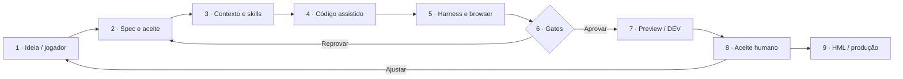
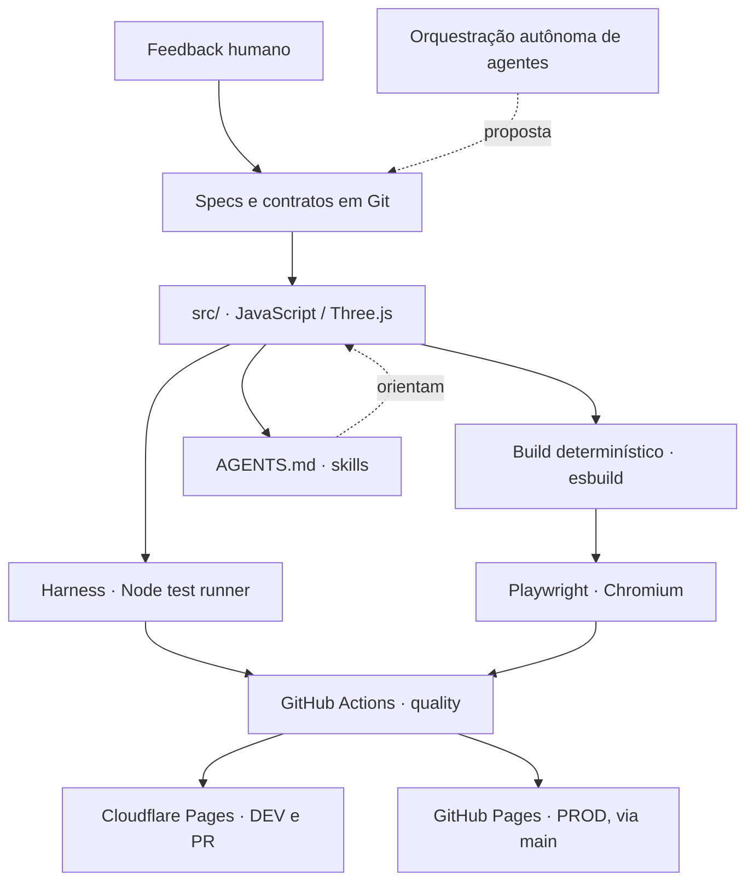

# Nova Wing 3D — Portfolio Case · AI SDLC

### Um laboratório prático para experimentar um novo jeito de construir software

**Produto:** jogo 3D de naves para WebGL, com campanha, Five Cats, chefes, robô, progressão e suporte mobile.

**Desafio de engenharia:** transformar feedback em código verificável, mantendo controle sobre mudanças, testes, arquitetura, versões e deploys mesmo com apoio intensivo de IA.

**Tese:** acelerar o protótipo é útil; acelerar o ciclo **ideia → comportamento aceito → entrega rastreável** é o que importa.

[**Jogar**](https://trucco86.github.io/nova-wing-3d/) · [**Experimentar DEV**](https://dev.nova-wing-preview.pages.dev/) · [**Ler estudo completo**](case/CASE-STUDY.md) · [**Evidências**](case/EVIDENCIAS.md)

## O que este case procura demonstrar

| Dimensão | Antes de estruturar o processo | Prática adotada no repositório |
| :--- | :--- | :--- |
| **Contexto** | Requisitos ficam dispersos em pedidos e conversas | `AGENTS.md`, skills, specs e ADRs versionados |
| **Feedback** | Problemas de UX relatados informalmente | Descrição do desvio, critério de aceite e teste |
| **Implementação** | Mudanças pontuais podem gerar regressões indiretas | Fonte modular, diff revisável e build reproduzível |
| **Verificação** | Testar manualmente somente o caminho feliz | Harness determinístico + Playwright real |
| **Entrega** | Dificuldade de saber qual versão foi testada | PR, SHA, ambiente e execução de CI associados |
| **Aprendizado** | Correções sem memória técnica permanente | Changelog, evidências, revisão de regras e backlog |

Esta tabela descreve o **modelo e mecanismos existentes**, não comprova redução de tempo ou custo. O [plano de métricas](case/METRICAS.md) apresenta como medir esses efeitos com rigor.

## Pipeline · visão executiva

### Exemplo recente: uma correção pequena não é necessariamente simples

Ao reorganizar o menu mobile, a alteração funcional estava pronta antes de o release estar liberado. O build falhou por arquivo HTML gerado desatualizado. O gate de formatação e o contrato de versionamento impediram que aquela candidata passasse como se estivesse correta. Em seguida, Playwright apontou um botão de ação inacessível em paisagem. A solução exigiu uma correção específica, com novo commit e novo teste.

O mesmo ciclo se repetiu no áudio da turbina do robô: feedback subjetivo do jogador foi convertido em alterações de timbre, dinâmica, mute e testes automatizados, sem declarar que um teste unitário prova qualidade de mixagem.

[**Analisar PRs, commits e logs do caso real**](case/CICLO-REAL-OUTUBRO-2026.md).

## O que efetivamente existe

Os componentes de implementação, testes e entrega são [inspecionáveis](../src/). O pipeline de papéis autônomos com handoffs instrumentados é uma **proposta de evolução**; não há alegação de agentes independentes residentes desenvolvendo o jogo sem revisão.

## Onde a IA agrega valor no laboratório

**Prototipagem e exploração.** Gera hipóteses, alternativas de implementação e experimentos visuais mais rapidamente; o teste de uso decide o que permanece.

**Código e refatoração.** Apoia a edição dos módulos, composição de interfaces e implementação de gameplay. Specs e diffs ajudam a conter escopo e regressão.

**Qualidade e revisão.** Ajuda a pensar em casos de borda, testes e checks, mas a fonte de verdade é o resultado verificável do harness, do browser e do revisor.

**Evolução da entrega.** Explicita ambientes, gates e condições de promoção. Uma execução verde não substitui o aceite de ergonomia, diversão ou áudio.

## Arquitetura e controles

| Fronteira | Solução atual | Risco que reduz |
| :--- | :--- | :--- |
| Runtime | Three.js/WebGL + Web Audio + armazenamento local | Separar renderização, áudio e estado |
| Build | `src/` → `tools/build.mjs` → `index.html` | Deriva entre fonte e artefato |
| QA | Harness em JS real + Playwright | Regressões funcionais e de navegação |
| Deploy | Branches `dev`, `hml`, `main` e previews Cloudflare | Misturar protótipo não aprovado com release |
| Identidade | Firebase Google Auth no fluxo web habilitado por ambiente | Acoplar identidade de teste ao modo visitante |
| Ranking | Cliente experimental e backend Worker/D1 em evolução | Confundir UI de leaderboard com serviço validado |

[Arquitetura de plataforma](ARCHITECTURE-PLATFORM.md) · [Ambientes](DEPLOY-ENVIRONMENTS.md) · [Segurança e consentimento do ranking](RANKING-CLOUDFLARE.md).

## Métricas: o que observar sem criar números

Para tornar este case quantitativo, é necessário medir lead time por entrega, tempo ativo humano, retrabalho, duração dos gates, número de regressões, falhas após deploy, custo de execução de modelos e taxa de aceite. Também é preciso comparar trabalhos equivalentes e declarar os limites do experimento.

**Nenhuma porcentagem de produtividade, economia ou autonomia é apresentada como resultado medido.** Veja o [plano de mensuração](case/METRICAS.md).

## Mensagem para líderes de tecnologia

O Nova Wing permite observar, em uma superfície pequena e visível, uma mudança que também importa para sistemas maiores: **quando é fácil gerar software, é ainda mais importante definir o que deve funcionar e como provar que funciona**.

A experiência prática está documentada, com código, erros, PRs e decisões. O resultado que o projeto efetivamente demonstra é um **processo de aprendizado com entregas inspecionáveis**. A próxima fronteira é medir eficiência ponta a ponta e automatizar responsabilidades sob limites claros.

---

**Explore em sequência:** [História](case/CASE-STUDY.md) · [Ciclo real](case/CICLO-REAL-OUTUBRO-2026.md) · [Papéis / handoffs](case/PAPEIS-E-HANDOFFS.md) · [Como reproduzir](case/REPRODUZIR.md)

English summary

Nova Wing 3D is a playable 3D space shooter and a practical AI-assisted SDLC case study. Its engineering story is about reducing the time between user feedback and verified software changes through explicit specs, versioned context, deterministic harnesses, browser tests and traceable CI/CD. Autonomous multi-agent orchestration and productivity gains remain hypotheses requiring instrumentation, not established outcomes.

