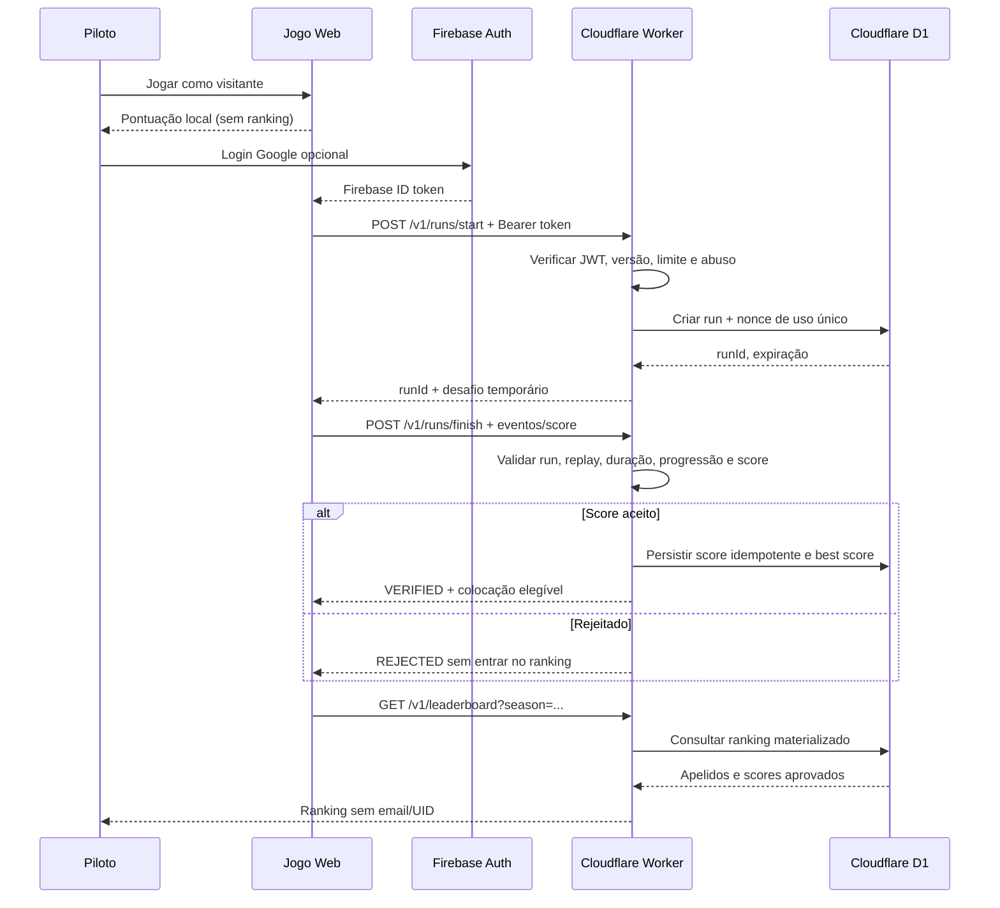

# Ranking competitivo — Cloudflare Workers + D1 e Firebase Auth

> **ESTADO: ARQUITETURA-ALVO; NÃO IMPLEMENTADO/NÃO PUBLICADO.** Cloudflare Pages já hospeda o HTML nos ambientes de teste, mas não existe Worker API, D1, backend de score, endpoints públicos, integração do frontend com ranking nem validação server-side implantados. O Firebase Auth de DEV não torna o ranking funcional.

## 1. Decisão e responsabilidades

Direção proposta para atender à integração Firebase + Cloudflare solicitada:

- **Firebase Authentication:** login social Google e emissão de ID token.
- **Cloudflare Pages:** arquivos estáticos do jogo, DEV, HML e previews de PR.
- **Cloudflare Worker:** API HTTPS e fronteira de confiança do ranking, token verification, rate limit, verificação de runs, regras por temporada e moderação.
- **Cloudflare D1:** persistência SQL de jogadores (mínima), sessões de run, resultados verificados e tabela materializada de leaderboard.
- **Jogo:** score local e diversão offline. Participação em ranking remoto opcional, separada do progresso da campanha.

A [PR #57](https://github.com/trucco86/nova-wing-3d/pull/57) tem uma **proposta anterior incompatível** baseada em Firestore + Cloud Functions, com regras não implantadas. Manter a PR em draft para revisão/arquivamento; **não combinar dois backends gravando o mesmo score**. A adoção de Worker/D1 só se torna efetiva após uma implementação separada, migrations, CI e validação de segurança.



## 2. Contratos HTTP propostos

**Todas as rotas são futuras. Não apresentar estes caminhos como URLs existentes.**

- `GET /v1/health` — estado da API sem expor secrets.
- `GET /v1/leaderboard?season=<slug>&limit=20&cursor=<opaque>` — somente apelidos moderados, score, setor e timestamp público limitado; paginação limitada.
- `POST /v1/runs/start` — autenticado; retorna `runId`, `nonce`, `expiresAt` e versão autorizada. Sem score ainda.
- `POST /v1/runs/finish` — autenticado; `runId`, evidência compacta, pontuação declarada e `Idempotency-Key`. Servidor decide `verified/rejected`.
- `GET /v1/me` — autenticado; apelido/consentimento e histórico próprio permitido.
- `PATCH /v1/me` — autenticado; atualização de apelido com moderação, sem permitir mutação do score.
- `DELETE /v1/me` — autenticado; solicitação de eliminação/anonimização com política de retenção e auditoria.

Conferir `Content-Type`, tamanho máximo de payload, origem permitida, método e erro padronizado. CORS deve limitar o uso navegador, **mas não é mecanismo de autenticação**.

## 3. Modelo de dados lógico (D1 proposto)

```text
players(
  uid TEXT PRIMARY KEY,            -- Firebase UID; nunca público
  nickname TEXT,                   -- sanitizado e moderado
  consent_at TEXT,
  created_at TEXT
)
seasons(
  season_id TEXT PRIMARY KEY,
  starts_at TEXT, ends_at TEXT,
  rule_set TEXT, enabled INTEGER
)
runs(
  run_id TEXT PRIMARY KEY,
  uid TEXT REFERENCES players(uid),
  season_id TEXT REFERENCES seasons(season_id),
  build_sha TEXT, nonce_hash TEXT UNIQUE,
  started_at TEXT, expires_at TEXT,
  status TEXT, idempotency_key TEXT
)
scores(
  score_id TEXT PRIMARY KEY,
  run_id TEXT UNIQUE REFERENCES runs(run_id),
  uid TEXT REFERENCES players(uid),
  season_id TEXT REFERENCES seasons(season_id),
  points INTEGER, sector INTEGER,
  duration_ms INTEGER, verified_at TEXT,
  verdict_version TEXT
)
leaderboard_entries(
  season_id TEXT REFERENCES seasons(season_id),
  uid TEXT REFERENCES players(uid),
  best_score_id TEXT REFERENCES scores(score_id),
  PRIMARY KEY (season_id, uid)
)
```

O esquema acima é **design**, não migração executada. Constraints, índices, transações e políticas de retenção devem ser revisadas antes do primeiro deploy. Usar queries preparadas e parâmetros via `env.DB.prepare(...).bind(...)` para impedir SQL injection. Migrations nunca devem rodar automaticamente contra PROD a partir de PR preview.

## 4. Segurança mínima obrigatória

- Validar Firebase ID token com **biblioteca confiável compatível com Workers**: RS256, assinatura, `kid`/chaves Google, `aud`, `iss`, `exp`, `iat`, `sub`, `auth_time` e ambiente esperado. Chaves públicas podem ser cacheadas conforme Cache-Control; nunca confiar em `decode` sem `verify`.
- Usuário autenticado não pode escrever em D1 diretamente. Worker usa bindings internos; nenhum token de DB é exposto ao cliente.
- Não aceitar score autodeclarado apenas porque usuário está autenticado. Implementar validação autoritativa de regras por setor, XP, recursos, duração, sequência de eventos, seed, limites e versões.
- Nonce criptograficamente imprevisível de uso único por run, expiração curta, idempotência no finish e deduplicação transacional.
- Rate limiting por identidade e sinal de abuso, proteção contra spam e limites máximos de duração/tamanho/score. Nunca usar IP bruto como identificador público.
- Separar `dev`, `hml`, `prod`: Worker, D1, credenciais/config JWT, temporadas e dados independentes. Previews não compartilham credenciais de escrita de PROD.
- Permissões mínimas para deploy; segredos em Cloudflare/GitHub secrets. Rotacionar credenciais após incidentes. Não versionar JSON de service account.
- Auditar tentativas rejeitadas com amostragem/retention e dados mínimos. Limitar leitura de histórico privado.
- **Limite explícito:** nenhum anti-cheat em browser prova que o JS não foi adulterado. Antes de um ranking competitivo confiável, requer replay/simulação autoritativa de eventos ou mecanismos equivalentes de validação. Até lá, scores podem ser marcados **experimentais/não verificados** e não constituem ranking oficial.

## 5. Integração com o código atual

Estado verificado do cliente em `dev`:

- `src/google-auth.js` já apresenta login, nome, sessão e logout, porém não expõe contrato de token para um cliente de API e não integra score/checkpoint com UID.
- Pontuação e progressão continuam locais. A conta Google não altera o equilíbrio do jogo.
- Cloudflare Pages publica HTML; nenhum binding D1/Worker está no workflow atual.
- A fundação Firestore da PR #57 ainda está isolada. Não promover regras ou Callable Functions por engano.

Implementação sugerida em PRs pequenas, **sem produção**:

1. **R-API-01** — spec, código Worker, testes unitários JWT/claims/erros e fake D1 local, configuração separada DEV.
2. **R-API-02** — migrations D1, modelo de seasons/players/runs/scores, teste de constraints, idempotência e transações.
3. **R-API-03** — run start/finish, verificador de regras e suíte adversarial; sem habilitar leaderboard competitivo até haver autoridade suficiente.
4. **R-API-04** — leitura pública segura, nickname e consentimento LGPD, exclusão/anônimização, monitoramento e observabilidade.
5. **R-WEB-05** — botão de ranking na web, conexão `getIdToken()` após consentimento, fallback offline, testes desktop/mobile.
6. **R-REL-06** — HML com dados sintéticos, load/rate tests, revisão de permissões/custos, aceite e deploy PROD posterior.

## 6. Gate de entrega e aceitação

- [ ] Projeto Worker separado criado e D1 DEV provisionado; IDs e segredos não estão no código público.
- [ ] JWT inválido, expirado, ambiente incorreto, `alg` inesperado, token adulterado e sem token recebem 401.
- [ ] Replay de run, score impossível, idempotency key repetida e payload gigante não alteram leaderboard.
- [ ] Concorrência de finish não publica pontuação duas vezes.
- [ ] Rankings e respostas públicas não exibem email, UID, token ou progresso privado.
- [ ] Apelido, consentimento, exclusão, política de dados e rate limit definidos.
- [ ] DEV/HML com testes, observabilidade, orçamento de D1/Workers e rollback.
- [ ] Homologação humana antes de habilitar competição em produção.

Referências técnicas: https://firebase.google.com/docs/auth/admin/verify-id-tokens e https://developers.cloudflare.com/d1/worker-api/prepared-statements/.
