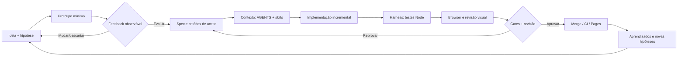
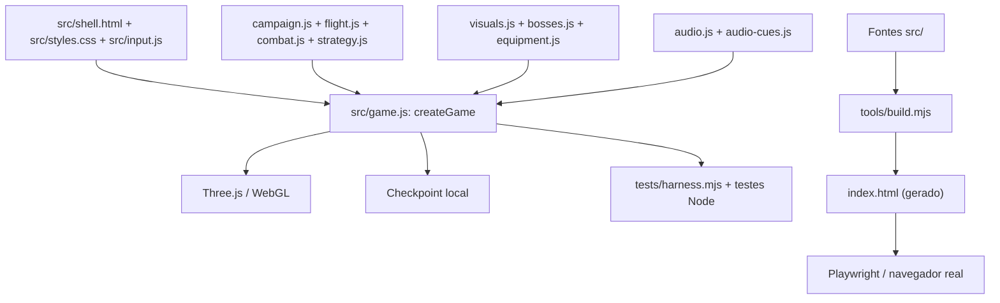

# Arquitetura do case: do aprendizado à entrega verificável

Este documento descreve a arquitetura **do processo de engenharia**. A arquitetura do jogo está em [ARQUITETURA.md](../ARQUITETURA.md). O Nova Wing não possui um backend de agentes executando durante a partida.

## Fluxo de valor, incluindo feedback rápido

O primeiro loop é propositalmente leve: nem toda hipótese merece arquitetura extensiva. Quando o protótipo começa a ser reutilizado e evoluído, o contrato e os gates passam a controlar a mudança. Esse é um **modelo de referência** para o projeto, não prova de que todas as passagens são automatizadas por agentes distintos.

## Decomposição técnica do produto

O motor renderiza com Three.js 0.170.0, fixado no [package.json](../../package.json). O arquivo HTML raiz é derivado de `src/`, e `npm run build:check` verifica sua consistência. Alterações de comportamento pertencem à fonte; editar o bundle gerado manualmente seria fonte de divergência.

## Harness: o mecanismo que encurta o feedback

O [harness determinístico](../../tests/harness.mjs) instancia **o jogo de produção**, mas injeta relógio, aleatoriedade, eventos, DOM e renderer. Isso permite reproduzir movimento, limites, cadência, pausa, chefes, checkpoint e casos de regressão sem renderizar uma GPU real em cada teste.

A suíte de [navegador](../../tests/browser/) complementa os mocks: controla a página de verdade, WebGL, interação e captura. Ainda são necessários testes humanos para áudio, ergonomia de toque, desempenho térmico e legibilidade em dispositivos reais.

## CI/CD e fronteiras

O [workflow](../../.github/workflows/ci.yml) executa validações em PRs e pushes. No fluxo web, o job de publicação depende da conclusão do gate browser; o release versionado possui dependências adicionais declaradas. A [execução de referência da v1.15](https://github.com/trucco86/nova-wing-3d/actions/runs/39591873578) foi registrada como sucesso, referente exclusivamente ao respectivo commit.

As proteções administrativas de merge não podem ser inferidas do YAML: devem ser verificadas separadamente no GitHub. Aprovação humana, políticas de segurança e critérios de UX não se tornam automáticos porque existem testes.

## Três níveis de maturidade

| Nível | Estado | Evidência |
| --- | --- | --- |
| **1. Contexto e ferramentas** | Existente | [AGENTS.md](../../AGENTS.md), [skills](../../skills/README.md), [specs](../../specs/README.md) |
| **2. Harness e CI/CD com rastreabilidade** | Existente | [testes](../TESTES.md), [workflow](../../.github/workflows/ci.yml), [execução](https://github.com/trucco86/nova-wing-3d/actions/runs/39591873578) |
| **3. Agentes independentes por etapa, com handoffs observáveis** | Modelo proposto; requer instrumentação e provas | [Papéis](PAPEIS-E-HANDOFFS.md), [métricas](METRICAS.md) |

## Princípio transferível

O projeto é um ambiente controlado de aprendizado; o que pode ser levado a produtos empresariais é o **padrão de trabalho**: critérios de aceite, fronteiras de contexto, validação independente, políticas de release e observabilidade. O produto empresarial precisaria de controles específicos de segurança, dados, confiabilidade, impacto financeiro e operação.
