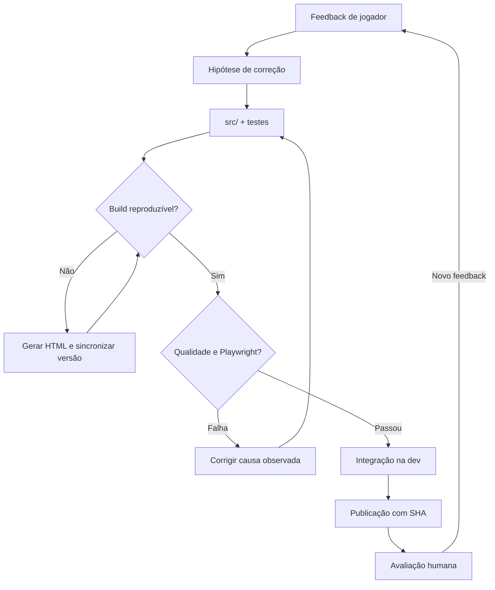

# Um ciclo real de AI SDLC — Nova Wing · outubro de 2026

**Pergunta:** o que acontece quando uma mudança visual aparentemente simples encontra as fronteiras de build, qualidade e experiência de uso?

**Resposta documentada:** o processo encontra o problema antes ou durante a entrega, registra a correção e vincula cada versão a um commit e a um ambiente. Este registro reúne fatos de código e CI, sem inferir homologação visual de um status verde.

[Voltar ao case](README.md) · [Ver matriz de evidências](EVIDENCIAS.md) · [Abrir repositório](https://github.com/trucco86/nova-wing-3d)

## Linha do tempo · 28 de outubro de 2026

| Momento | O que motivou | Trabalho e evidência | O que aprendemos |
| :--- | :--- | :--- | :--- |
| **Menu e experiência** | Botões desalinhados, ranking em lugar inadequado, login Google mal posicionado e trilha pouco energética | [PR #131](https://github.com/trucco86/nova-wing-3d/pull/131) e [PR #132](https://github.com/trucco86/nova-wing-3d/pull/132) | Pedido visual precisa virar mudança de comportamento e layout rastreável |
| **Build e controle de versão** | HTML gerado incompatível com alterações em `src/`; formatação e versionamento exigidos | [PR #132](https://github.com/trucco86/nova-wing-3d/pull/132), release **1.27.2**, [deploy DEV](https://github.com/trucco86/nova-wing-3d/actions/runs/40739691957) | CI é útil justamente quando impede liberar uma mudança incompleta |
| **Mobile paisagem** | Playwright identificou ação da missão fora do viewport em **844×390** | [PR #133](https://github.com/trucco86/nova-wing-3d/pull/133), versão **1.27.3**, [deploy DEV](https://github.com/trucco86/nova-wing-3d/actions/runs/40743883711) | Responsividade deve cobrir acesso à ação, não só estética |
| **Áudio da turbina** | Feedback de que o som contínuo do robô era cansativo | [PR #134](https://github.com/trucco86/nova-wing-3d/pull/134), versão **1.27.4**, [CI com quatro shards](https://github.com/trucco86/nova-wing-3d/actions/runs/40744556964), [deploy DEV](https://github.com/trucco86/nova-wing-3d/actions/runs/40744797302) | Testes comprovam mute, estado e amplitude; qualidade percebida exige escuta humana |
| **Novos experimentos** | Necessidade de entrar em qualquer fase/chefe para testar sem percorrer a campanha | [PR #135](https://github.com/trucco86/nova-wing-3d/pull/135), candidata **1.27.5** (em validação na data desta página) | Um modo QA aumenta velocidade de feedback, mas deve proteger progresso e ranking |

Os links de CI se referem às execuções e versões indicadas. A disponibilidade do serviço, o resultado dos jobs e o estado de aprovação devem ser conferidos nos próprios links; não há extrapolação para commits futuros.

## Como o fluxo trabalhou

O caso tem duas classes de feedback: **automática**, reproduzível por execução, e **humana**, como ergonomia e conforto auditivo. Ambas são necessárias, mas não são a mesma prova.

## Evidências que você pode abrir

| Tipo | Link | O que verificar |
| :--- | :--- | :--- |
| Código e release de menu | [PR #132](https://github.com/trucco86/nova-wing-3d/pull/132) | Diferença de menu, ranking, artefato gerado e versão |
| Regressão de viewport | [PR #133](https://github.com/trucco86/nova-wing-3d/pull/133) | CSS de rolagem em paisagem e teste |
| Ajuste de áudio com aceite subjetivo | [PR #134](https://github.com/trucco86/nova-wing-3d/pull/134) | Sintetizador, teste de mute e limite de escopo |
| Ambiente publicado | [Run de DEV v1.27.4](https://github.com/trucco86/nova-wing-3d/actions/runs/40744797302) | SHA, saída do Wrangler e alias Cloudflare |
| Testes reais de navegador | [CI PR #134](https://github.com/trucco86/nova-wing-3d/actions/runs/40744556964) | Quality, `browser-shard` 1–4 e gate agregado |
| Próxima capacidade | [PR #135](https://github.com/trucco86/nova-wing-3d/pull/135) | Testes de acesso direto a setores/chefes, isolamento do ranking |

## Por que a falha também é parte do case

Se o objetivo fosse mostrar só resultados, o histórico teria sido resumido a “implementamos a correção e publicamos”. Isso omite os custos e os problemas importantes.

A falha de build mostra a utilidade do contrato fonte → artefato. O problema de viewport mostra a diferença entre “o HTML existe” e “o usuário consegue tocar no botão”. O ajuste do som mostra um limite da automação: mesmo com teste verde, **a percepção humana do áudio é parte do aceite**.

Esta é uma história mais confiável para discutir AI SDLC do que números de produtividade não instrumentados.

## Próxima etapa de maturidade

Registrar por mudança: intenção, spec, PR, base e SHA, tempo de resposta do CI, retrabalho, execução humana, aceite e defeitos pós-deploy. Com esse histórico, comparar tarefas equivalentes e testar se papéis especializados com handoffs produzem ganhos líquidos.

[Plano de métricas](METRICAS.md) · [Papéis propostos](PAPEIS-E-HANDOFFS.md) · [Guia de reprodução](REPRODUZIR.md)
