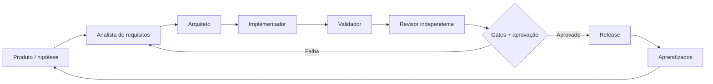

# Agentes especializados: papéis, contratos e handoffs

> **Modelo operacional proposto, não automação atualmente comprovada.** O repositório já fornece `AGENTS.md`, skills, ferramentas e CI; as funções abaixo são fronteiras de responsabilidade para uma evolução futura. Uma pessoa pode desempenhar múltiplos papéis, com ou sem agentes. Não é um diagrama de agentes executando hoje em produção.

## Pipeline de responsabilidades



| Papel/Agente          | Responsabilidade                                    | Entrada mínima                    | Saída e evidência                                    | Não pode fazer                            |
| --------------------- | --------------------------------------------------- | --------------------------------- | ---------------------------------------------------- | ----------------------------------------- |
| **Product Discovery** | Formular hipótese, usuário, problema e teste rápido | Feedback, objetivo, restrições    | Brief com hipótese falsificável e critérios de valor | Definir sucesso sem feedback              |
| **Requirements**      | Traduzir intenção em spec observável                | Brief aceito, histórico relevante | `specs/<mudança>.md`, critérios e não escopo         | Alterar produção sem revisão              |
| **Architecture**      | Propor design mínimo e trade-offs                   | Spec, mapa, ADRs, dependências    | Design note/ADR, interfaces e riscos                 | Introduzir arquitetura sem justificativa  |
| **Implementation**    | Editar somente código e testes necessários          | Spec, design, skill de domínio    | Diff, testes associados, build                       | Editar `index.html` manualmente           |
| **Quality**           | Encontrar contraexemplos e regressões               | Diff, spec, fixtures              | Testes Node, browser, screenshots e limitações       | Declarar sucesso sem execução             |
| **Reviewer**          | Revisar código, contexto, segurança e cobertura     | PR + relatórios por SHA           | Aprovação ou pedidos de correção                     | Aceitar relato do agente como prova       |
| **Delivery**          | Verificar gates e autorizações                      | SHA, branch, política de release  | Deploy/rollback e link da execução                   | Pular checks ou publicar SHA não validado |
| **Learning**          | Consolidar falhas, padrões e métricas               | Incidentes, feedback, logs        | ADRs, skills, specs e plano de melhoria              | Inventar ROI, DORA ou causalidade         |

## Contrato entre papéis

Cada passagem deve incluir:

```yaml
task_id: example-hud-mobile
source_of_truth:
  - specs/web-v1-15-hud-settings.md
intent: 'Liberar área de gameplay e simplificar pausa'
scope:
  - src/game.js
  - src/styles.css
  - src/shell.html
acceptance:
  - 'Título do setor some após a janela definida'
  - 'Reiniciar/sair exigem confirmação'
verification:
  commands:
    - npm run validate
    - npm run validate -- --browser
  expected_artifacts:
    - 'artifacts/validation.json'
    - 'capturas Playwright quando necessário'
handoff:
  current_owner: 'Implementação'
  next_owner: 'Qualidade'
  human_review_required: true
release_ready: false
```

_Este YAML é um **exemplo de contrato**, não uma configuração de orquestrador executada hoje._

## Política de gates

1. **Hipótese:** há problema observável, critério de aceitação e escopo?
2. **Contexto:** foram lidos os módulos relevantes, a spec e a skill correspondente?
3. **Implementação:** o diff fica limitado ao escopo e não reescreve artefatos gerados?
4. **Validação:** rodaram testes reais com evidência do commit? Mudanças visuais passaram pelo browser?
5. **Revisão:** problemas de comportamento, acessibilidade, desempenho e segurança foram examinados?
6. **Entrega:** checks exigidos concluídos, versão e link de deploy confirmados?
7. **Aprendizado:** divergências entre hipótese e resultado foram documentadas?

## Skills existentes e a diferença para agentes

As skills [gráficos](../../skills/nova-wing-graficos/SKILL.md), [áudio](../../skills/nova-wing-audio/SKILL.md), [dinâmica](../../skills/nova-wing-dinamica/SKILL.md), [física](../../skills/nova-wing-fisica/SKILL.md) e [entrega](../../skills/nova-wing-entrega/SKILL.md) definem _como executar um trabalho de domínio_. Elas **não são agentes independentes**. Um agente seria um executor com identidade, contexto, permissões e trajetória de execução; o harness e os gates limitariam sua atuação.

## Caminho de evolução para múltiplos agentes reais

- Primeiro, aplicar esse contrato em tarefas pequenas e registrar revisões.
- Depois, instrumentar tool calls, custo, duração, taxa de retrabalho e IDs de execução por papel.
- Somente então delegar handoffs automáticos, com limites de acesso, sandbox, revisão humana e recuperação.
- Antes de divulgar autonomia, mostrar **runs reais** com proveniência, não apenas YAML, prompts ou diagramas.

[Arquitetura do case](ARQUITETURA-DO-CASE.md) · [Métricas](METRICAS.md) · [Harness](../HARNESS.md)
