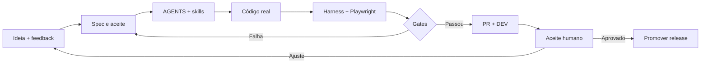

# CASE STUDY · NOVA WING 3D

### AI-Assisted Software Development Lifecycle

**O jogo é o produto. A engenharia da mudança é o experimento.**

Captura real de gameplay WebGL. Este case distingue o que foi implementado, testado, publicado e homologado.

---

## A hipótese que virou um produto

O Nova Wing começou como um exercício criativo: construir um jogo de nave inspirado em experiências clássicas de combate, usando IA como apoio ao desenvolvimento.

O desafio mudou com o crescimento do produto: **como adicionar fases, chefes, modos de combate, controles mobile e áudio sem transformar cada nova entrega em uma nova regressão?**

A resposta trabalhada no repositório é organizar o caminho **intenção → spec → implementação → testes → entrega → feedback** com regras, artefatos e pontos de verificação.

> [!IMPORTANT]
> Este é um **case real e auditável de engenharia assistida por IA**, supervisionada por pessoas. Não é uma demonstração de uma fábrica de agentes autônomos já operante, nem um estudo controlado que tenha medido ROI ou percentuais de produtividade.

## O ciclo em uma imagem

### Cinco pilares documentados

| Pilar                        | Artefato                                                                  | Por que importa                                                  |
| :--------------------------- | :------------------------------------------------------------------------ | :--------------------------------------------------------------- |
| **Contexto explícito**       | [AGENTS.md](../../AGENTS.md) + [skills](../../skills/)                    | Agentes e humanos encontram premissas, limites e critérios       |
| **Intenção verificável**     | [specs](../../specs/)                                                     | Requisito deixa de ser somente uma conversa                      |
| **Harness reprodutível**     | [tests/harness.mjs](../../tests/harness.mjs)                              | Regressões de estado e lógica sem obrigar GPU real               |
| **Validação de experiência** | [Playwright](../../tests/browser/)                                        | Browser real cobre clique, layout, cenas e controles             |
| **Release rastreável**       | [CI/CD](../../.github/workflows/ci.yml) + [changelog](../../CHANGELOG.md) | Cada decisão pode ser relacionada a PR, SHA, execução e ambiente |

## Case concreto: uma mudança de menu atravessa o pipeline

O histórico de **outubro de 2026** contém exemplos de problemas que apareceram depois de uma implementação inicial: build gerado divergente, regras de versão e formatação, botão inacessível em paisagem e feedback sobre som cansativo de turbina.

Esses problemas levaram a correções incrementalmente entregues nas versões 1.27.2–1.27.4, com PRs e logs de CI. O objetivo da narrativa não é esconder falhas: é mostrar **como elas se tornaram tarefas testáveis e mudanças rastreáveis**.

[**Abrir o ciclo completo de outubro, com evidências**](CICLO-REAL-OUTUBRO-2026.md)

## Escolha como explorar o estudo

| Trilha                          | Documento                                                      | Leitura                                                   |
| :------------------------------ | :------------------------------------------------------------- | :-------------------------------------------------------- |
| **Narrativa executiva**         | [CASE-STUDY.md](CASE-STUDY.md)                                 | Problema, decisões, implicações e aprendizados            |
| **Uma entrega auditável**       | [Ciclo real de outubro](CICLO-REAL-OUTUBRO-2026.md)            | PRs, falhas, CI e deploy                                  |
| **Arquitetura do processo**     | [ARQUITETURA-DO-CASE.md](ARQUITETURA-DO-CASE.md)               | Ciclo e fronteiras de qualidade                           |
| **Papel dos agentes**           | [PAPEIS-E-HANDOFFS.md](PAPEIS-E-HANDOFFS.md)                   | Modelo futuro de handoffs, sem alegar automação existente |
| **Evidência e limites**         | [EVIDENCIAS.md](EVIDENCIAS.md)                                 | Fatos, rastreabilidade e o que não se pode afirmar        |
| **Decisões**                    | [DECISOES.md](DECISOES.md)                                     | Trade-offs e riscos                                       |
| **Métricas**                    | [METRICAS.md](METRICAS.md)                                     | Como medir produtividade, qualidade e DORA                |
| **Reproduzir**                  | [REPRODUZIR.md](REPRODUZIR.md)                                 | Rodar, inspecionar e verificar                            |
| **Evidência em novas entregas** | [TEMPLATE-EVIDENCIA-ENTREGA.md](TEMPLATE-EVIDENCIA-ENTREGA.md) | Registro de SHA, gates, validação humana e limites        |
| **Apresentação**                | [DECK.md](DECK.md) / [VIDEO.md](VIDEO.md)                      | Roteiros para contar a história                           |

### O que foi desenvolvido e o que é proposta

**Hoje:** contexto versionado, skills, specs, ferramentas, harness determinístico, suíte browser, releases e ambientes separados.

**Em evolução:** qualidade gráfica/mobile baseada em mais dispositivos, melhores dados para comparação de eficiência, identidade/ranking com infraestrutura e testes específicos, maior automação de QA.

**Proposto:** agentes independentes por etapa, handoffs automáticos observáveis e medição de custo/eficiência por papel.

## Por que importa além do jogo?

Um protótipo rápido ensina o que pode ser construído. Um ciclo verificável ensina **o que pode ser alterado com confiança**.

Em produtos corporativos, o mesmo princípio vale para checkout, APIs, plataformas e automação: regras explícitas, isolamento de ambiente, testes observáveis e revisão humana continuam sendo essenciais quando a implementação é assistida por IA.

**[Ver a visão executiva para portfólio](../PORTFOLIO-AI-SDLC.md)** · [README do projeto](../../README.md) · [Evidências](EVIDENCIAS.md)

<strong>English abstract</strong>

Nova Wing is a working WebGL game and an inspectable AI-assisted software engineering case. The main challenge is not code generation; it is converting subjective feedback into scoped, tested and traceable changes. The repository documents actual context files, domain skills, tests, CI, PRs and deploys. Autonomous multi-agent handoffs and productivity gains remain hypotheses to evaluate.

