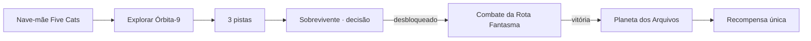

# Five Cats Universe — Fundação de exploração e missões

**Status: domínio versionado e testável, ainda sem interface jogável.** Esta branch é independente de #138 / #140 / #142 e parte da DEV homologada 1.27.5, sem alterar o runtime atual.

## O primeiro mistério: Sinais de Órbita-9

Bia e os Five Cats saem da nave-mãe e investigam uma estação abandonada. Para descobrir a Rota Fantasma de Órion, devem recuperar **três pistas**: transmissão de socorro, mapa do reator e baliza danificada. Só depois um sobrevivente apresenta duas escolhas: restaurar energia ou seguir uma rota clandestina. A escolha desbloqueia um combate; a vitória revela um planeta novo e permite resgatar uma recompensa **uma única vez**.

## Regras implementadas em `src/exploration-quests.js`

- Grafo de quatro destinos, incluindo uma base, região investigável, missão de combate bloqueada e planeta desbloqueável.
- Coleta de pistas válida somente na região correta; IDs desconhecidos e duplicatas são rejeitados.
- Diálogo de escolha exige as três pistas, não pode ser revertido sem um novo save e controla o desbloqueio de rota.
- Missão exige rota e vitória; derrota não desbloqueia planeta; recompensa sem duplicação.
- Normalização de estados inválidos, saves antigos ou corrompidos; não aceitar flags incoerentes.
- Persistência usa **somente** `nova-wing-3d-exploration-v1`; checkpoint `nova-wing-3d-v1` da campanha existente não é modificado.
- Sessões Developer/QA impedem gravações de progresso; nenhuma dependência de Firebase, ranking ou D1.

## Ainda **não** existe nesta branch

Interface de exploração livre 3D, deslocamento no mundo, scanner visual, NPC animado, mapa, tela de diálogo ou transição para combate. O módulo é **foundation de domínio** e seus contratos. Não comunicar como “mundo aberto entregue”.

## Próxima entrega funcional do vertical slice

1. Criar uma área navegável da estação usando a renderização Three.js, com colisão e câmera própria.
2. Ligar os três itens investigáveis ao `inspectEvidence`, com feedback e diário.
3. Interface de interação do sobrevivente, com escolhas e consequência visível.
4. Implementar transição exploração → fase existente usando `canTravel`, e retorno.
5. Usar save próprio, rollback, QA state injection sem writes e testes Playwright.
6. Homologar desktop/mobile em preview. Promover a DEV apenas após aceite.

**Referência de backlog:** [épico #139](https://github.com/trucco86/nova-wing-3d/issues/139).

## Evidência de qualidade

Testes em `tests/exploration-quests.test.mjs`: desbloqueio condicional, rejeição de IDs inválidos, decisões imutáveis, recompensa idempotente, recuperação de JSON corrompido e separação do save legado. O módulo é puro JavaScript, sem mockar o sistema de arquivo do jogo.

A branch não altera produção, HML nem DEV.
