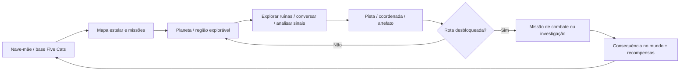
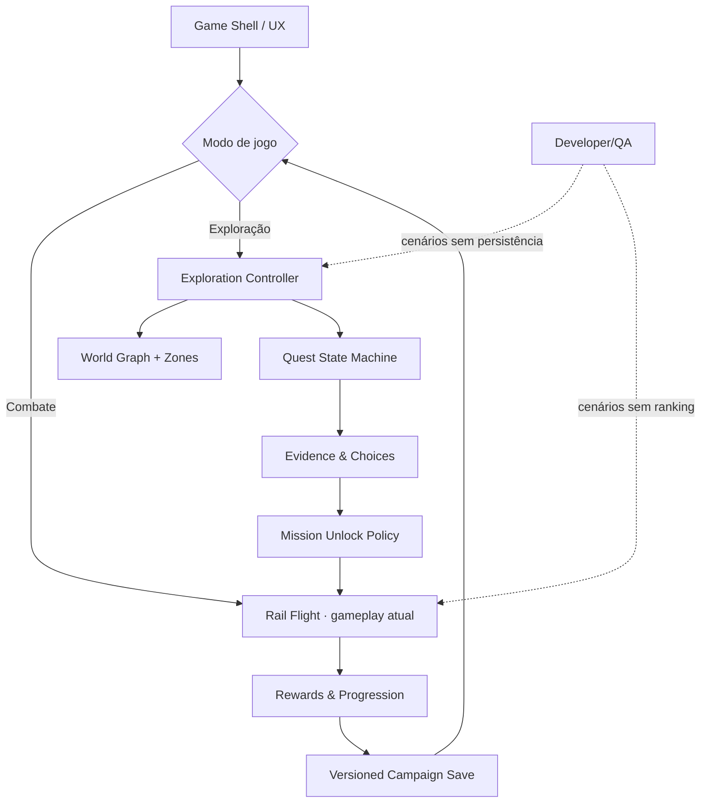

# Nova Wing: mundos vivos, combate tático e exploração Five Cats

**Status:** proposta de produto e arquitetura para a próxima geração do Nova Wing. A entrega v1.27.6 cobre somente o **primeiro ciclo jogável**: cenários menos repetitivos, novas perspectivas e evolução dos padrões de combate. **Mundo aberto ainda não foi implementado.**

## Problema observado

Na homologação de 28/10/2026, o jogador relatou repetição de lua rachada, Terra, satélites e naves, pouca alternância de câmera, inimigos gigantes pouco expressivos e chefes cuja mecânica se repete. Isso prejudica surpresa, progressão e curiosidade: dez setores diferentes no catálogo não bastam quando a experiência espacial permanece semelhante.

Referência criativa: o combate estratégico e a exploração de **Panzer Dragoon Saga** (posicionamento ao redor do inimigo, riscos por setor, pontos fracos e descoberta de ruínas). A proposta utiliza esses princípios com universo, personagens, ambientes, artes e mecânicas próprios de Five Cats — sem copiar elementos protegidos.

## Princípios do novo design

1. **Cada lugar parece um lugar novo:** identidade geográfica, luz, arquitetura, materiais, fauna/máquinas, obstáculos, áudio e clima.
2. **Cada chefe propõe um problema:** estudo do inimigo, mudança de posição, ataques que reagem às decisões do piloto, consequências por destruir módulos.
3. **Perspectiva é mecânica, não apenas câmera:** tomadas laterais, superiores, primeira pessoa escolhida pelo jogador e sequências de aproximação ligadas ao objetivo.
4. **Atividade com intenção:** escolta, interceptação, investigação, fuga, sabotagem, resgate e caçada; menos inimigos repetidos em ondas infinitas.
5. **Exploração gera consequência:** encontrar coordenadas, falar com NPCs, decifrar sinais e recuperar itens habilitam rotas, recompensas e novos planetas.
6. **Evoluir sem regressão:** rail shooter e partidas rápidas preservados; exploração deve funcionar também com save, QA e controle de acesso por ambiente.

## Contraste de mundos · dez setores

| Setor | Silhueta e atmosfera | Perspectiva / ação | Assinatura de combate |
| :--- | :--- | :--- | :--- |
| 01 · Ascensão orbital | Cidade e horizonte da Terra exclusivos da decolagem | Câmera lateral no corredor urbano e subida | Interceptação sob torres |
| 02 · Porto submerso | Docas e spires subaquáticos; sem lua | Vista superior no mergulho | Escolta contra ferrões laterais |
| 03 · Cinturão de destroços | Rochas, lua rachada **somente aqui**, cavernas | Plano aberto e corte lateral na entrada | Perfurador em investida |
| 04 · Órbita-9 | Docas, anéis industriais e reator | Vista superior de geometria da estação | Sabotagem de módulos |
| 05 · Tempestade de plasma | Arcos solares e nuvens carregadas | Vista lateral entre correntes | Mergulhos de fogo |
| 06 · Lua congelada | Horizonte azulado **sem rachaduras** e fissuras de gelo | Superior para evitar colosso | Passos sísmicos e canhões nos braços |
| 07 · Colmeia viva | Espinhos orgânicos, membranas e nódulos | Lateral em túnel vivo | Hidra atacando de várias cabeças |
| 08 · Frota de Marvin | Fragatas quebradas e baterias laterais | Plano aberto e superior entre couraçados | Broadside coordenado |
| 09 · Abismo de Órion | Lentes gravitacionais e vazio, sem Terra | Lateral na anomalia | Pulsos gravitacionais |
| 10 · Trono de Marvin | Portões industriais, fortaleza e buraco negro | Plano amplo na aproximação final | Ataques combinados e fases de eclipse |

A v1.27.6 usa formas procedurais existentes; assets premium, áudio e animação sofisticada seguem como evolução de produção. Novos elementos de fundo não devem gerar hitboxes invisíveis.

## Boss Combat 2.0

### Regiões de dano

| Zona | Comportamento pretendido |
| :--- | :--- |
| **Blindagem selada / escudo ativo** | Dano nulo, feedback audiovisual de bloqueio |
| **Corpo comum / carcaça** | Dano pequeno; o jogador percebe desgaste, mas não ignora mecânicas |
| **Gerador, membro ou arma vulnerável** | Dano alto, resposta de cor, estado e destruição de módulo |
| **Núcleo crítico exposto** | Multiplicador elevado, encerramento do combate possível |

Os anéis amarelo-claros de alvo devem pulsar, indicar direção no radar e ficar no topo de prioridade de informação, sem colocar texto sobre o meio da tela. Fazer o chefe passar de fase por **HP e pelo estado dos módulos**, não só por cronômetro. Estudar futuramente resistência por arma: plasma, cinético, arcano e bombas.

### Chefes com mecânicas reais

- **Perfurador:** investidas com rastro; desviar e atirar nos anéis que giram para frear a broca.
- **Fortaleza Órbita-9:** destruir geradores para reduzir os escudos e abrir o reator.
- **Colosso glacial:** pisões, ondas de choque, alternância entre braço-artilharia e ombro exposto.
- **Hidra viva:** cabeças com padrões independentes; destruir uma cabeça muda o ângulo das outras.
- **Couraçado Ômega:** baterias nas laterais, coberturas e múltiplos lados de ataque.
- **Bastião do vazio:** campo gravitacional altera perigos da arena; núcleo muda de localização.
- **Marvin:** fases táticas de interceptação, perseguição e confronto final, com aumento progressivo de agressividade.

**Regra de qualidade:** cada chefe precisa de ao menos um ataque novo de efeito perceptível, uma decisão espacial e uma vulnerabilidade com feedback visual inequívoco. A v1.27.6 inicia essa diferenciação por origens, sequências, cadência e multiplicadores; **destruição funcional de membros e novas arenas completas são entregas seguintes**.

## Proposta: Five Cats Universe · exploração RPG

### Estrutura

### Loop jogador

**Viajar → explorar → descobrir → decidir → combater → evoluir → abrir novos destinos.**

O Five Cats deve poder se reunir em uma base, interagir com NPCs, navegar pelo espaço, pousar em pontos de interesse e coletar evidências. A descoberta de uma tecnologia alienígena pode, por exemplo, revelar a localização de um portal e desbloquear uma missão de rail shooter numa nova lua. Uma região explorável não precisa ser interminável: **zonas abertas densas, pequenas e bem desenhadas** são uma primeira aposta mais viável e divertida.

### Vertical slice recomendado (não implementado)

**“Sinais de Órbita-9”**: Bia, Jenifer e Bob investigam uma estação silenciosa com um mapa navegável; escaneiam três transmissões, encontram um técnico sobrevivente, escolhem entre restaurar energia ou abrir uma rota clandestina, e desbloqueiam uma batalha diferente conforme a decisão.

**Critérios de aceite:** deslocamento livre num espaço delimitado, três pontos inspecionáveis, um diálogo com escolha, diário de pistas, flag de missão persistida, gate de combate só após descoberta, mini mapa, botão para voltar à nave e QA para reproduzir cada estado.

### Arquitetura sugerida

A fonte de verdade deve ficar em módulos próprios; não misturar a máquina de quests com `src/game.js`. O save atual `nova-wing-3d-v1` deve ser preservado e migrado explicitamente antes de introduzir flags narrativas. Novo caminho não deve assumir autenticação Google ou D1 para progresso local.

## Roadmap proposto

| Onda | Prioridade | Escopo | Prova necessária |
| :--- | :--- | :--- | :--- |
| **D1 — Diversidade e câmera** | P0 | Corrigir fundos repetidos, set dressing, janelas laterais/superiores e robôs articulados | Testes por setor + screenshots mobile/desktop |
| **D2 — Bosses 2.0** | P0 | Dano de carcaça x ponto fraco, HP, origens de ataques diferenciadas, marcadores | Testes de dano, cadência, fases e gameplay |
| **D3 — Mecânicas especiais** | P1 | Efeitos exclusivos de pelo menos três chefes, arenas e colisões especiais | QA por chefe + balanceamento |
| **D4 — Vertical slice de exploração** | P1 | Hub, mini mapa, pistas, diálogo, gate de missão e save de quest | Fluxo end-to-end com checkpoint |
| **D5 — Galáxia conectada** | P2 | Zonas e planetas adicionais, NPCs, facções, mistérios, escolhas e eventos | Métricas de diversão, retenção e tempo de exploração |

## Métricas e aceite

Medições propostas: percentual do tempo passado em perspectivas distintas, entropia de encontros por setor, tempo de chefe, proporção de dano no casco / fraco, taxa de sucesso e frustração, FPS P95 e consumo de memória em mobile. Esses valores precisam de **baseline e instrumentação**; não afirmar números ganhos sem coleta.

**Ambientes:** testar em PR preview e DEV; promover a HML só após gates e aceite humano. Nada desta proposta autoriza publicação em produção.
