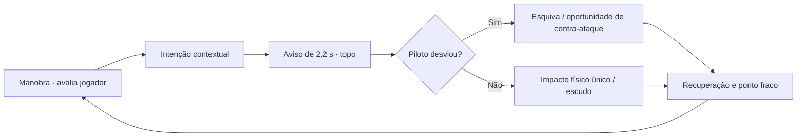

# Combate inteligente e câmera contextual — Game Design 1.27.8

> Resposta ao playtest da campanha. A 1.27.8 permanece uma candidata até CI, preview e aceite humano.

## 1. Problema e hipótese

**Problema:** chefes giram e disparam aleatoriamente, dificultando reconhecer intenção; buffs curtos e ataques especiais pouco efetivos enfraquecem a progressão RPG; mudanças automáticas de câmera quebram a leitura dos controles.

**Hipótese:** ataques físicos com pré-aviso, janelas de esquiva e comportamento reativo, combinados com supers de impacto e câmeras ligadas a uma missão, criam confrontos menos repetitivos sem elevar artificialmente o número de projéteis.

## 2. Máquina de comportamento

As entradas da decisão são o estado do boost, o robô, a posição e flanco atual, a vida/fase e quais geradores ainda funcionam. Todas as decisões usam regras locais puras e têm testes repetíveis. Não há IA generativa inferindo durante o combate.

## 3. Vocabulário de combate

| Ataque | Ameaça | Contra-medida |
| :--- | :--- | :--- |
| Mordida | Investida na posição assinalada | Deslocamento lateral ou vertical durante aviso |
| Garra | Varre o flanco de aproximação | Reposicionar a nave e orbitar |
| Tentáculo | Agarrão rastreado | Sair da área demarcada |
| Varredura | Área horizontal extensa | Trocar altura |
| Martelo | Impacto concentrado | Escapar da área de impacto |
| Broca | Avanço veloz | Esquiva da trajetória e contra-ataque no gerador |

**Compatibilidade:** o dano da carcaça continua limitado, o núcleo não fica vulnerável sem destruir geradores e a proteção por Barreira/rolamento continua válida.

## 4. Contrato de câmera

A alternância de câmera **não é um recurso decorativo**. O reator da Órbita-9 possui um trecho tático no plano X/Z com obstáculos próprios; a câmera revela o plano que o jogador pode navegar, sem perder a nave do campo de visão.

Em todas as demais fases, manter o enquadramento original até construir uma atividade que exija outro ponto de vista. Respeitar escolha manual de cockpit/combate.

## 5. Métricas para aferir o resultado

Instrumentar: percentual de ataques antecipados e evitados; frequência de contato físico versus disparos; distribuição de dano por casco/geradores/núcleo/especiais; tempo de chefe; FPS P95 por aparelho; taxa de morte e reclamações de câmera. Nenhum ganho deve ser declarado antes da coleta.

## 6. Evidência de engenharia

- [PR #138 — Mundos](https://github.com/trucco86/nova-wing-3d/pull/138)
- [PR #140 — Chefes com assinaturas](https://github.com/trucco86/nova-wing-3d/pull/140)
- [AI SDLC Case](../case/README.md)
- [Design Five Cats Universe](FIVE-CATS-UNIVERSE.md)

**Não substituir** a versão homologada DEV nem promover a HML/PROD até os gates estarem verdes e o jogador avaliar a experiência.
